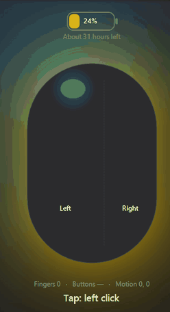
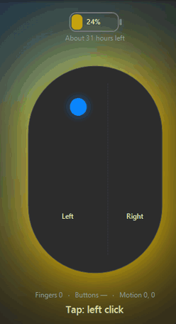
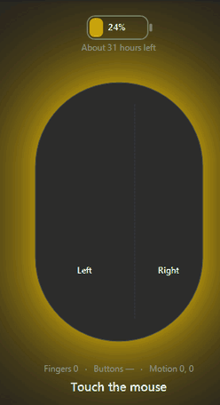
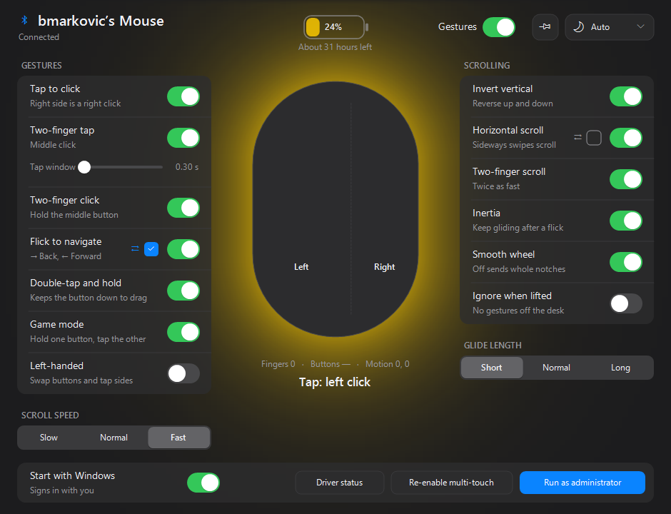

# magic-mouse-windows

Makes the **original Apple Magic Mouse (2009, model A1296, Bluetooth)** work properly on Windows:
smooth trackpad-style scrolling with inertia, tap to click, two-finger gestures, pinch to zoom,
flick to go back and forward, and battery level. All of it is configured from one settings window.

It is two parts:

- **mmfilter.sys**: a small KMDF filter driver. It switches the mouse into multi-touch mode,
  reads the touch reports Windows normally never sees and hands them to the app. Pointer and
  buttons keep working through the normal Windows mouse driver.
- **MagicMouseNative.exe**: a tray app that turns the touches into scrolling, clicks and
  gestures, and shows them live on a drawing of the mouse.

| Gliding | Clicking | Tapping |
|:---:|:---:|:---:|
|  |  |  |



## Features

**Scrolling**
- Smooth, high-resolution scrolling with a one-finger swipe (sub-notch wheel steps, like a
  precision touchpad), with acceleration for fast swipes.
- Inertia: a fast swipe keeps gliding and slows down naturally. Touch the mouse to stop it.
- Horizontal scrolling, two-finger scrolling at double speed, and inverted (natural) scrolling
  for either direction.
- Scroll speed (Slow / Normal / Fast) and glide length (Short / Normal / Long).
- A "Smooth wheel" switch for older apps that only understand whole notches.

**Clicking and gestures**
- Tap to click: the left side is a left click and the right side is a right click.
  These clicks go through the driver as the mouse's own button presses, so they work in
  administrator windows too.
- Two-finger tap = middle click, with an adjustable tap window and tolerance for shaky fingers.
- Two-finger click and hold = middle button (for example, to pan in 3D and CAD apps).
- Double-tap and hold keeps the button down, so you can drag files and windows without pressing.
- Flick left or right = Back / Forward (the direction can be reversed).
- Pinch to zoom with two fingers. It is sent as a native touch pinch, so browsers and photo viewers
  zoom smoothly around the pointer, and you can pan while zoomed.
- Game mode: hold one button and tap the other side to press both, for example to aim and shoot.
- Left-handed mode swaps the buttons and the tap sides.
- Ignore when lifted: no gestures while the mouse is off the desk (it reports being lifted).

**App**
- A live view of every finger on the mouse: colours show the order the fingers landed in, a
  glow shows clicks, and streaks show gliding.
- Battery level in the window, tray icon and taskbar button, with an estimate of the time left
  that learns from your use. The glow turns yellow below 35 % and red below 15 %.
- Shows when the mouse is asleep or searching, and lets you rename the mouse's Bluetooth name.
- Light, dark or automatic theme; always on top; start with Windows.

## Requirements

- The **2009 Magic Mouse (A1296)**, paired over Bluetooth. The Magic Mouse 2 and later are a
  different device and aren't supported.
- 64-bit Windows 10 or 11.
- Remove other Magic Mouse drivers first (Magic Utilities, Apple Boot Camp's
  `applewirelessmouse`), because they sit on the same device.
- **Test signing.** The driver is test-signed, not Microsoft-signed, so Windows only loads it with
  test signing on. That needs Secure Boot turned off in the UEFI setup, then
  `bcdedit /set testsigning on` and a reboot. If BitLocker is on, have your recovery key ready
  before you change Secure Boot settings.

## Building and installing

You need Visual Studio 2022 or later with Desktop development with C++, the Windows Driver Kit
10.0.28000 and the Windows SDK 10.0.26100 (the WDK lacks the Bluetooth headers and signtool).

From an **x64 Native Tools Command Prompt for VS**:

```bat
cd driver
build.bat          :: builds and test-signs out\mmfilter.sys
cd ..\app
build.bat          :: builds MagicMouseNative.exe
```

Then, from an **administrator** prompt:

```bat
driver\install.bat
```

`install.bat` checks test signing and Secure Boot, trusts the test certificate, and installs the
filter on the Magic Mouse. Then start `app\MagicMouseNative.exe`. It lives in the tray, and a click
on the tray icon opens the window.

To remove the driver, run `driver\uninstall.bat` as administrator.

## How it works

```
Magic Mouse ──Bluetooth──> BthEnum ──> mmfilter.sys ──> HidBth ──> mouhid (pointer + buttons)
                                          │
                                          │  touch frames (\\.\MagicMouseNative)
                                          ▼
                                 MagicMouseNative.exe ──> scrolling, clicks, pinch (SendInput / touch injection)
```

- The filter sits below HidBth and watches the Bluetooth L2CAP traffic. It sends the mouse
  feature report `D7 01`, which turns on multi-touch.
- In multi-touch mode the mouse sends report `0x29`: motion, buttons and up to 16 eight-byte
  touch records. The filter queues these for the app and rewrites each one into the plain mouse
  report `0x10`, so the pointer keeps working through the normal Windows mouse driver.
- The filter also reads the battery (feature report `0x47`), passes on lift reports (`0x61`),
  and injects tap clicks as the mouse's own button reports.
- The app's gesture engine is in [app/engine.h](app/engine.h).

## Tools

- `probe/`: checks whether touch reports reach user mode without the driver (they don't).
- `tools/mmcapture`: logs touch frames to a text file. Close the app first.
- `tools/mmreplay`: runs a capture through the gesture engine and prints the scrolling, clicks
  and how quickly each stroke started scrolling. Use it to tune gestures without the mouse.

## Limitations

- Scrolling, middle click, Back/Forward and held buttons are sent with `SendInput`. Windows
  doesn't deliver that to administrator windows unless the app runs as administrator too (there
  is a button for that). Left and right taps go through the driver and always work.
- Some games with anti-cheat ignore injected input, so game mode and held buttons may not work
  in those games.
- The driver is test-signed only.
