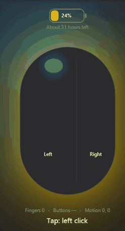
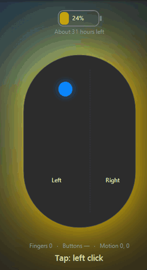
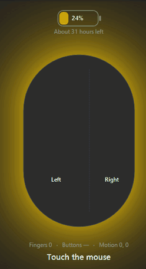
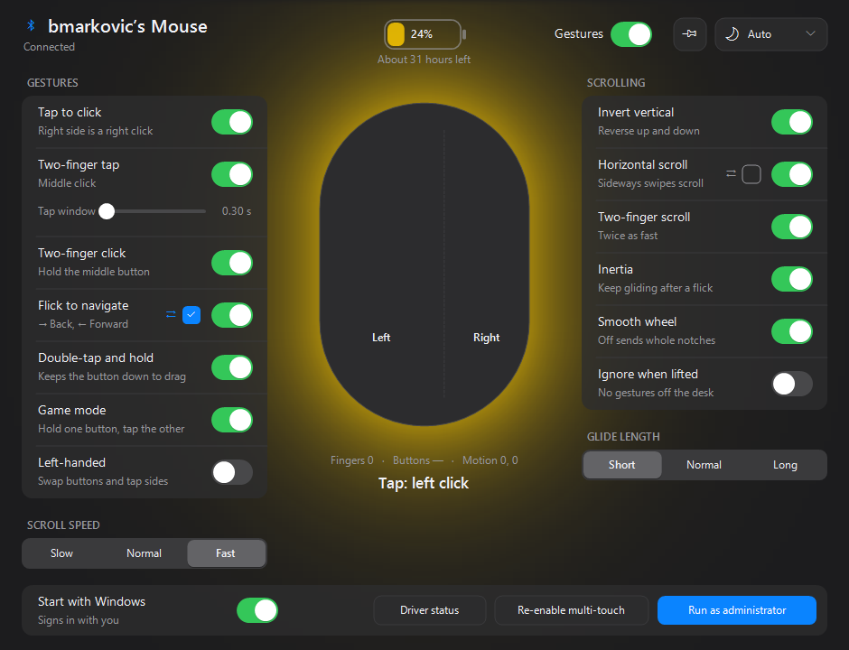

# magic-mouse-windows

Makes the **original Apple Magic Mouse (2009, model A1296, Bluetooth)** work properly on Windows:
smooth trackpad-style scrolling with inertia, tap to click, two-finger gestures, pinch to zoom,
flick to go back and forward, and battery level. All of it is configured from one settings window.

It is two parts:

- **mmfilter.sys**: a small KMDF filter driver. It switches the mouse into multi-touch mode,
  reads the touch reports Windows normally never sees and hands them to the app. Pointer and
  buttons keep working through the normal Windows mouse driver.
- **MagicMouseNative.exe**: a tray app that turns the touches into scrolling, clicks and
  gestures, and shows them live on a drawing of the mouse.

| Gliding | Clicking | Tapping |
|:---:|:---:|:---:|
|  |  |  |



## Features

**Scrolling**
- Smooth, high-resolution scrolling with a one-finger swipe (sub-notch wheel steps, like a
  precision touchpad), with acceleration for fast swipes.
- Inertia: a fast swipe keeps gliding and slows down naturally. Touch the mouse to stop it.
- Horizontal scrolling, two-finger scrolling at double speed, and inverted (natural) scrolling
  for either direction.
- Scroll speed (Slow / Normal / Fast) and glide length (Short / Normal / Long).
- A "Smooth wheel" switch for older apps that only understand whole notches.

**Clicking and gestures**
- Tap to click: the left side is a left click and the right side is a right click.
  These clicks go through the driver as the mouse's own button presses, so they work in
  administrator windows too.
- Two-finger tap = middle click, with an adjustable tap window and tolerance for shaky fingers.
- Two-finger click and hold = middle button (for example, to pan in 3D and CAD apps).
- Double-tap and hold keeps the button down, so you can drag files and windows without pressing.
- Flick left or right = Back / Forward (the direction can be reversed).
- Pinch to zoom with two fingers. It is sent as a native touch pinch, so browsers and photo viewers
  zoom smoothly around the pointer, and you can pan while zoomed.
- Game mode: hold one button and tap the other side to press both, for example to aim and shoot.
- Left-handed mode swaps the buttons and the tap sides.
- Ignore when lifted: no gestures while the mouse is off the desk (it reports being lifted).

**App**
- A live view of every finger on the mouse: colours show the order the fingers landed in, a
  glow shows clicks, and streaks show gliding.
- Battery level in the window, tray icon and taskbar button, with an estimate of the time left
  that learns from your use. The glow turns yellow below 35 % and red below 15 %.
- Shows when the mouse is asleep or searching, and lets you rename the mouse's Bluetooth name.
- Light, dark or automatic theme; always on top; start with Windows.

**Apple keyboards** (after [MacKeys](https://github.com/dooperdrew/mackeys-win); not yet tested
on a real keyboard)
- Works with Magic Keyboards (with and without the numeric keypad or Touch ID), the Apple
  Wireless Keyboard and the wired Apple Keyboard, over USB or Bluetooth. Only active while one
  is connected, so other keyboards are never changed.
- Windows never reports the Fn key, so **Right Option is Fn**: Fn + arrows = Home / End /
  Page Up / Page Down, Fn + Backspace = Delete, Fn + Return = Insert.
- Top row: media keys first (Task View, Start, previous / play / next, mute, volume) with Fn for
  F1-F12, or the other way round. Fn + Esc switches.
- Command and Option swapped, so Alt and Windows sit where a PC keyboard has them.
- F13 / F14 / F15 = Print Screen / Scroll Lock / Pause.
- On AltGr layouts, the extra Left Ctrl Windows sends with Right Alt is dropped.
- Keyboard battery in the tray tooltip and menu, with a low-battery notice.
- Every option is in the tray menu under **Apple keyboard**.

## Requirements

- The **2009 Magic Mouse (A1296)**, paired over Bluetooth. The Magic Mouse 2 (A1657) and the
  USB-C Magic Mouse are also recognised over Bluetooth, but that support hasn't been tested on
  real hardware yet.
- An Apple keyboard is optional; its remapping needs no driver.
- 64-bit Windows 10 or 11.
- Remove other Magic Mouse drivers first (Magic Utilities, Apple Boot Camp's
  `applewirelessmouse`), because they sit on the same device. Apple's driver can instead be
  used on purpose, without test signing: see [Boot Camp mode](#boot-camp-mode-no-test-signing).
- **Test signing.** The driver is test-signed, not Microsoft-signed, so Windows only loads it with
  test signing on. That needs Secure Boot turned off in the UEFI setup, then
  `bcdedit /set testsigning on` and a reboot. If BitLocker is on, have your recovery key ready
  before you change Secure Boot settings.

## Installing

Download from [Releases](https://github.com/toasty-wheeler/magic-mouse-windows/releases). Pair
the mouse first, and make sure Secure Boot is off.

- **Installer** (`MagicMouseNative-x.y.z-setup.exe`): installs the app and puts the driver on
  the mouse. If test signing is off, setup offers to turn it on, and BitLocker is suspended for
  that one restart. The mouse doesn't work until you restart, so restart with the keyboard if
  you need to. Uninstall it from Windows' Apps settings; that also takes the driver off the mouse.
- **Portable** (`MagicMouseNative-x.y.z-portable.zip`): unzip anywhere, run
  `Install driver.cmd`, then `MagicMouseNative.exe`. Settings are saved in
  `MagicMouseNative.ini` next to the app instead of the registry. The driver is still installed
  in Windows, so run `Remove driver.cmd` before you delete the folder.

Both trust the driver's test certificate ("MagicMouseNative Test") in the machine's
certificate stores. That's how Windows accepts a test-signed driver package. Uninstalling
removes the certificate again.

### Boot Camp mode (no test signing)

After [OpenMagicMouse](https://github.com/haikieudng-cyber/OpenMagicMouse): instead of
mmfilter, Apple's own signed Boot Camp driver (`applewirelessmouse`) goes on the mouse, so
Secure Boot can stay on. Apple's driver switches the mouse into multi-touch mode, and the app
reads the touches from Windows' Bluetooth packet log (ETW). It works for the 2009 mouse and the
Magic Mouse 2 (Apple's driver doesn't list the USB-C mouse). Not yet tested end to end.

1. Get `AppleWirelessMouse.inf`, `.sys` and `.cat` from Apple's Boot Camp drivers (the
   AppleWirelessMouse64 package). They aren't included here.
2. Run `mmdriver bootcamp <path to AppleWirelessMouse.inf>`. It puts Apple's driver on the mouse
   and turns on full Bluetooth logging (`BTHPORT\Parameters\EtwLogSensitiveData`). Turn
   Bluetooth off and on afterwards.
3. Run the app **as administrator** (starting the Bluetooth trace needs it). It notices Apple's
   driver and says "Connected (Boot Camp driver)".

Apple's driver also scrolls by itself; the app drops that scrolling while a finger is on the
mouse and does its own. `mmdriver install` switches back to mmfilter. Differences from mmfilter:
taps go through `SendInput` (so administrator windows need the app elevated, which this mode
needs anyway), and "Re-enable multi-touch" can't resend the command.

**Don't turn test signing off while the driver is installed.** Windows checks the signature
every time it loads the driver, so it would block it and the mouse would stop working until
you turn test signing back on or remove the driver.

## Building from source

You need Visual Studio 2022 or later with Desktop development with C++, the Windows Driver Kit
10.0.28000 and the Windows SDK 10.0.26100 (the WDK lacks the Bluetooth headers and signtool).

From an **x64 Native Tools Command Prompt for VS**:

```bat
cd driver
build.bat          :: builds and test-signs out\mmfilter.sys
cd ..\app
build.bat          :: builds MagicMouseNative.exe
```

Then, from an **administrator** prompt:

```bat
driver\install.bat
```

`install.bat` checks test signing and Secure Boot, trusts the test certificate, and installs the
filter on the Magic Mouse. Then start `app\MagicMouseNative.exe`. It lives in the tray, and a click
on the tray icon opens the window.

To remove the driver, run `driver\uninstall.bat` as administrator.

To make the installer and portable zip, also build `setup\build.bat` (mmdriver.exe, the
install helper), then run `setup\package.bat`. It needs [Inno Setup](https://jrsoftware.org/isinfo.php)
and writes to `dist\`. The packages contain the driver as you built and signed it, so its
test certificate is yours.

## How it works

```
Magic Mouse ──Bluetooth──> BthEnum ──> mmfilter.sys ──> HidBth ──> mouhid (pointer + buttons)
                                          │
                                          │  touch frames (\\.\MagicMouseNative)
                                          ▼
                                 MagicMouseNative.exe ──> scrolling, clicks, pinch (SendInput / touch injection)
```

- The filter sits below HidBth and watches the Bluetooth L2CAP traffic. It sends the mouse
  feature report `D7 01`, which turns on multi-touch.
- In multi-touch mode the mouse sends report `0x29`: motion, buttons and up to 16 eight-byte
  touch records. The filter queues these for the app and rewrites each one into the plain mouse
  report `0x10`, so the pointer keeps working through the normal Windows mouse driver.
- The filter also reads the battery (feature report `0x47`), passes on lift reports (`0x61`),
  and injects tap clicks as the mouse's own button reports.
- The app's gesture engine is in [app/engine.h](app/engine.h).

## Tools

- `setup/mmdriver.exe`: installs (`install`), removes (`uninstall`) and checks (`status`) the
  driver without WDK tools. The installer and the portable version use it.
- `probe/`: checks whether touch reports reach user mode without the driver (they don't).
- `tools/mmcapture`: logs touch frames to a text file. Close the app first.
- `tools/mmreplay`: runs a capture through the gesture engine and prints the scrolling, clicks
  and how quickly each stroke started scrolling. Use it to tune gestures without the mouse.
- `tools/btcapture`: reads Boot Camp mode's touch source (Windows' Bluetooth packet log) for a
  few seconds and reports what it decoded. Run it as administrator while touching the mouse.
- `tools/hcitest`: checks the Bluetooth packet decoding ([app/hciraw.h](app/hciraw.h)) with
  hand-built packets.
- `tools/kbtest`: checks the Apple keyboard remapping ([app/keyboard.h](app/keyboard.h))
  without a keyboard, and lists the keyboards on the PC.

## Limitations

- Scrolling, middle click, Back/Forward and held buttons are sent with `SendInput`. Windows
  doesn't deliver that to administrator windows unless the app runs as administrator too (there
  is a button for that). Left and right taps go through the driver and always work.
- Some games with anti-cheat ignore injected input, so game mode and held buttons may not work
  in those games.
- The driver is test-signed only.
- Keyboard remapping applies to every keyboard while an Apple keyboard is connected: a
  low-level hook can't tell which keyboard a key came from. The physical Fn and Eject keys
  can't be used (Windows drops them).
